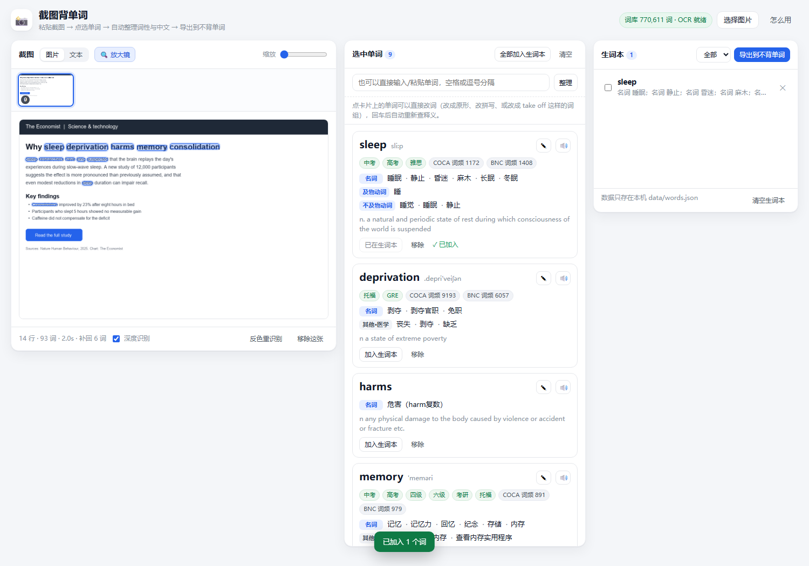
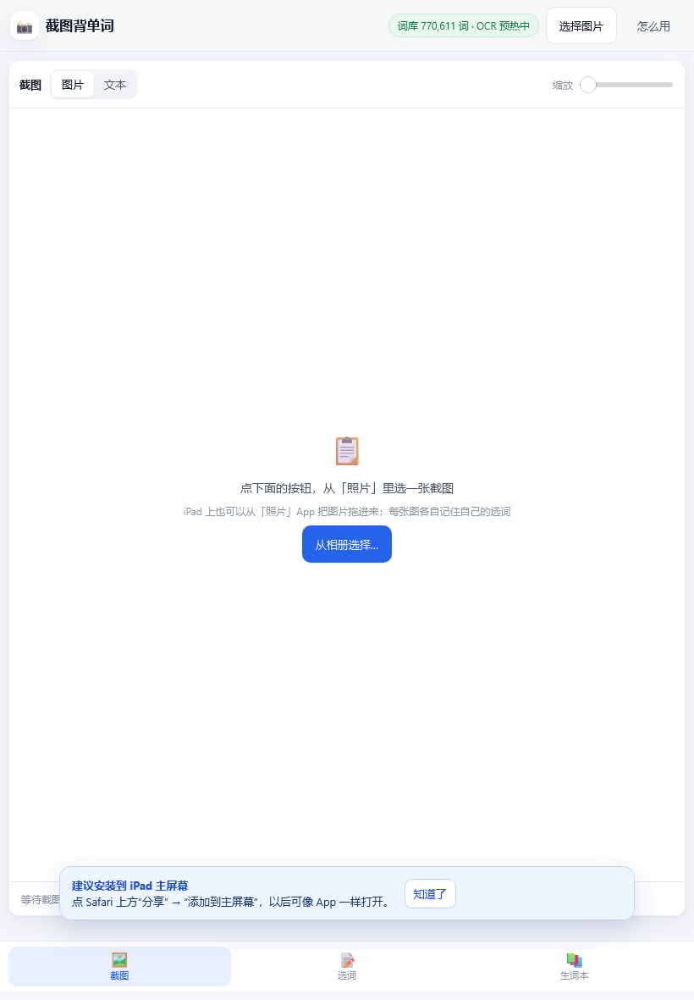
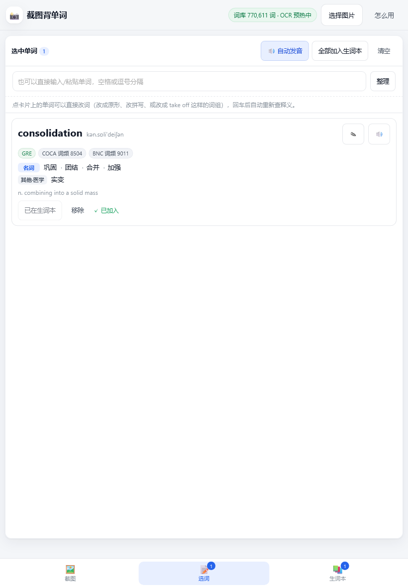
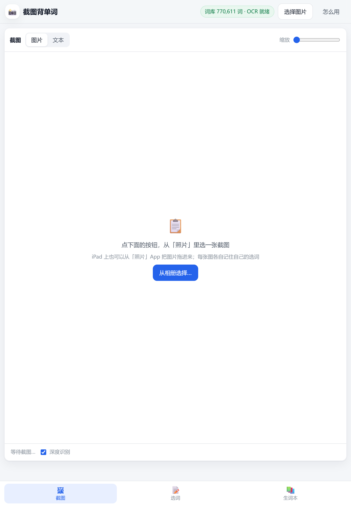
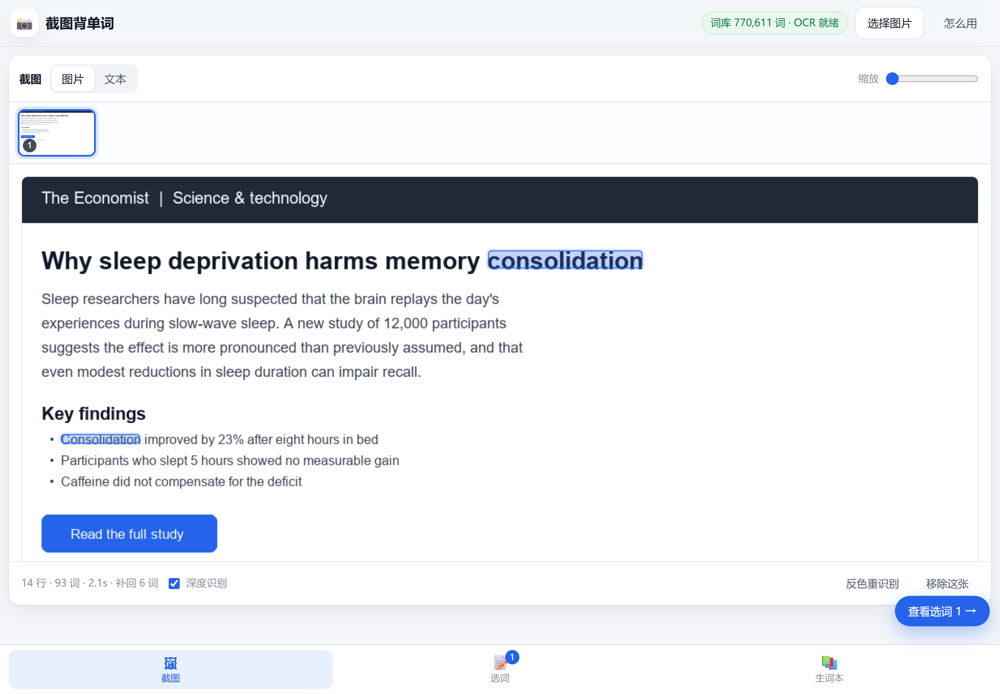
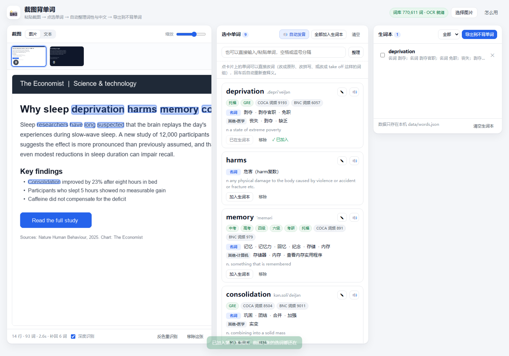
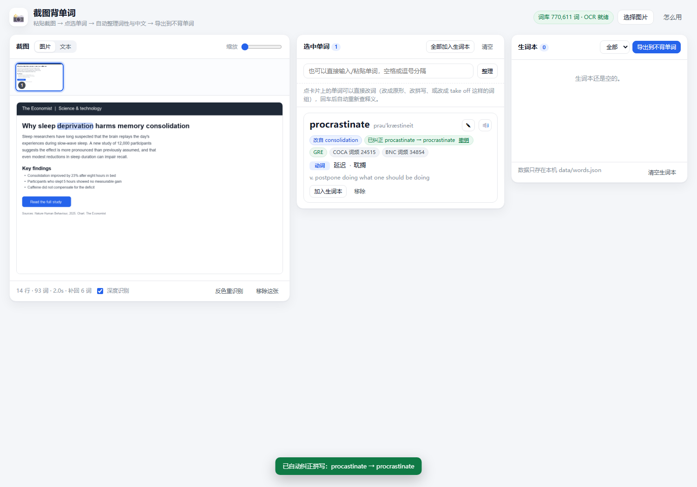
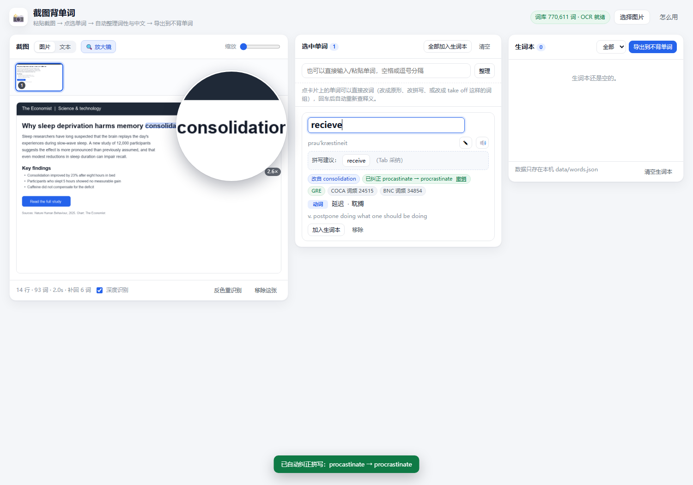
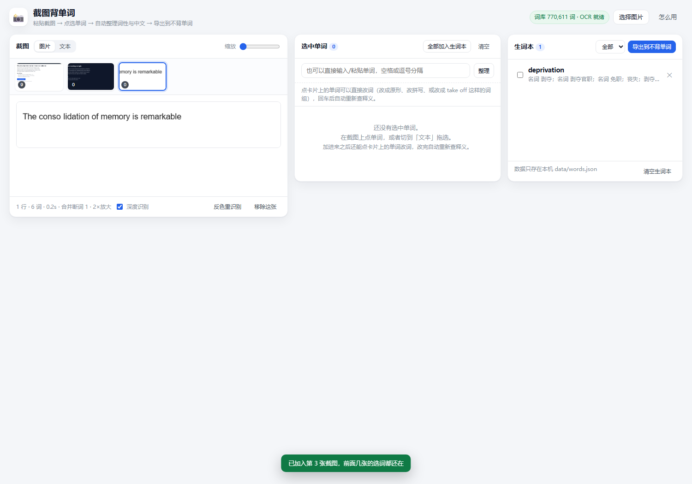

# 截图背单词 · Snap Vocab

[](https://github.com/GUSIHANGLUTA/snap-vocab)
[](LICENSE)
[](https://github.com/GUSIHANGLUTA/snap-vocab/releases/latest)

给一张英文截图，点选里面的单词，自动整理**词性 + 中文释义**，攒够一批一键导出成**不背单词「自制词书」**的 txt —— 导入就能背。

全部在本机跑：OCR 是本地 tesseract，词库是本地 ECDICT（77 万词），不联网也能用。



> **在线地址说明**：GitHub Pages 提供项目介绍、电脑版下载，以及可直接在 iPad Safari 中使用的独立网页版。独立版把 OCR、词库和生词本放进浏览器运行，不需要在 iPad 上执行 Windows 文件。

[项目主页](https://GUSIHANGLUTA.github.io/snap-vocab/) ·
[iPad 独立版](https://GUSIHANGLUTA.github.io/snap-vocab/ipad/) ·
[下载最新版本](https://github.com/GUSIHANGLUTA/snap-vocab/releases/latest) ·
[参与开源](https://github.com/GUSIHANGLUTA/snap-vocab)

## 快速开始

双击 **`启动截图背单词.cmd`**（桌面上是「截图背单词」快捷方式），浏览器会打开 <http://127.0.0.1:8910>。

**重复双击没关系**：启动器会先看服务是不是已经在跑 —— 在跑就直接把页面打开；没跑才启动；端口被别的程序占了会给一句人话提示。关掉那个控制台窗口就是停止服务。

命令行方式：

```bat
cd /d D:\新建文件夹\english-app
npm.cmd install
npm.cmd start
```

> 注意用 `npm.cmd` 而不是 `npm`：本机 PowerShell 执行策略禁止运行 `npm.ps1`。
> 想换端口：`set PORT=8911` 再双击（启动器会照这个端口起服务并打开对应页面）。

### 双击没反应 / 打不开时

| 现象 | 原因 | 处理 |
| --- | --- | --- |
| 黑窗口一闪就没了 | 服务本来就在跑 | 正常：浏览器已经打开；没打开就手动访问 <http://127.0.0.1:8910> |
| 窗口停住，提示端口被占用 | 8910 被别的程序占了 | 关掉占用它的程序，或 `set PORT=8911` 再双击 |
| 窗口停住，提示服务异常退出 | 依赖/数据坏了 | 看窗口里的报错；必要时删掉 `data/dict.sqlite` 让它重建 |
| 页面能开但顶栏写「连不上本机服务」 | 服务被关了（窗口关了） | 重新双击快捷方式 |
| 改了代码但页面还是旧的 | 服务进程还在跑旧代码 | 关掉旧的控制台窗口，再双击快捷方式 |

## 在 iPad 上直接使用（不需要电脑）

iPadOS 不能运行 Windows 的 `.cmd`、`.exe` 或 Node 服务，所以电脑版压缩包不能直接安装到 iPad。请改用独立网页版：

1. 在 iPad Safari 打开 <https://GUSIHANGLUTA.github.io/snap-vocab/ipad/>
2. 点 Safari 的分享按钮，选择 **添加到主屏幕**
3. 从主屏幕打开，选择相册里的英文截图，轻点单词即可查词

独立版包含：

- 浏览器内 Tesseract OCR（英语）
- 完整 ECDICT 77 万词库，按首字母分片加载
- 本地生词本与 TXT / CSV 导出
- Service Worker 离线缓存，用过资源后断网仍可打开

> 首次打开需要联网加载 OCR 和对应词库分片；图片和识别过程不上传到第三方。




本地修改后运行 `npm.cmd run ipad:build` 重新生成 `ipad/` 静态目录。

## 在 iPad Air / 手机上连接电脑（同一 Wi-Fi）

iPad 上跑不了 Node 服务，但可以让 iPad 直接连电脑上的这个服务。页面已经按 iPad Air 的尺寸做过适配（820×1180 竖屏 / 1180×820 横屏都是「底部标签 + 单栏」，不用横着拖）。

1. 电脑上双击 **`启动截图背单词-iPad.cmd`**（会监听局域网，窗口里打印出类似 `http://192.168.10.5:8910` 的地址）
2. iPad 连**同一个 Wi-Fi**，用 Safari 打开那个地址
3. 点 **「从相册选择…」** 挑截图（iPad 截图先存进「照片」），也可以从「照片」App 直接把图拖进页面
4. 在截图上**轻点单词**，底部「选词」标签会弹角标，点右下角「查看选词 N →」看卡片；底部三个标签就是 截图 / 选词 / 生词本
5. 导出的 txt：点「下载 .txt」会进「文件」App，或者直接点「复制」再粘到不背单词官网





> **安全**：iPad 版会监听 `0.0.0.0`，同一 Wi-Fi 里的设备都能访问，而且**没有登录**。所以只在自家/可信网络里开，用完关掉那个窗口就断开。别在公共 Wi-Fi 上用这个模式。
> **端口**：iPad 版同样认 `PORT`，比如 `set PORT=8911` 再双击。

## 怎么用

1. **给截图**：`Win` + `Shift` + `S` 截图，回到页面直接 `Ctrl` + `V`；也可以拖图片进来、点「选择图片」。
   **可以连着贴多张**：每张图各自记住自己的识别结果和选词，底部缩略图条点一下就能切回去，切回来一个字都不会丢（仅本次会话，刷新页面后清空）。
2. **选单词**（三种方式，可混用）：
   - 在截图上**直接点单词**，选中会高亮，再点一下取消；
   - 切到「文本」标签，像普通文字一样**鼠标拖选**一整句；
   - 或者在输入框里手动敲/粘贴单词。
   - **新选中的词排在最前面**（越新越靠上）；一次拖选/粘贴多个词时，这一批整体排到最上面，批内保持你选择的顺序。
   - **选中就自动朗读**（`speechSynthesis`，Chrome/Edge/Safari 自带语音，不联网）：点一个词读一个词；一次拖选一批时读这批的第一个，避免连珠炮。右上角「🔊 自动发音」可以关掉，**设置会记住**（localStorage）；卡片右上角的 🔊 可以随时手动再读一遍，改词/自动纠错后也会读一遍确认。
   - 图上小字看不清就用右上角的**缩放**滑块：它只放大截图那一块（在左边的框里滚动查看），整个页面不会跟着放大。

   
3. **看整理结果**：右侧卡片给出音标、按词性分组的中文释义（名词/及物动词/形容词…）、考试标签（中考/高考/四级/六级/考研/托福/雅思/GRE）、COCA/BNC 词频，以及**原形还原**（`screens → screen`、`ran → run`）。
4. **改词 + 自动纠错**：卡片上的单词**可以直接点开改**（✎ 按钮也行），回车后自动按新词重新查释义：
   - OCR 认错字母、想从 `screens` 改成 `screen`、从单个词改成 `take off` 这样的词组，都可以；
   - **拼写打错会自动纠正**：比如输入 `procastinate`，词库查不到但编辑距离只有 1，就直接换成 `procrastinate` 并给出释义，卡片上留一条「已纠正 procastinate → procrastinate · 撤销」；
   - 打字过程中也会在输入框下方给**拼写建议**，按 `Tab` 采纳、点击建议也行；
   - 手动输入/粘贴的未收录词不强行改，只给一个「是否想查 consensus？」的按钮，点一下才换；
   - 改成列表里已有的词会自动合并成一张卡，不会出现两张同词卡；
   - 如果这个词已经加进生词本，生词本里的条目会**跟着一起换**，并标注「改自 xxx」。

   
   
5. **看清小字**：小截图会自动 2–3 倍放大后再识别；「深度识别」开关会让 PSM 6 再扫一遍补回漏字（慢约一倍）。
   被拆开的单词（`conso lidation`）会按词库合回一个词，识别结果下方会写「合并断词 N」。

   
6. **加入生词本**：单张卡片点「加入生词本」，或点「全部加入生词本」。
7. **导出到不背单词**：点「导出到不背单词」→「复制」或「下载」拿到 `bubei-日期时间.txt`。

## 导出到不背单词（官方途径）

不背单词**没有公开接口**，官方支持的是「自制词书」上传，四步：

1. 复制 / 下载上一步的 txt（一行一个英文单词，官网只认英文部分）；
2. 浏览器打开 <https://bbdc.cn/lexis_book_index> 登录（手机号或微信）；
3. 网页左上角点「自制词书」，上传 txt —— 官网会用自己的词库重新匹配释义和例句；
4. 稍等片刻刷新网页，手机 App 里点「词书 / 换本词书 → 自制」就能开始背。

导出面板里也内置了这四步说明，右侧按钮可直接跳官网。

## 数据与隐私

| 内容 | 位置 |
| --- | --- |
| 你的生词本 | `data/words.json`（每次保存都会把上一版留成 `data/words.json.bak`，误清空时可手工找回） |
| 本地词库（ECDICT 77 万词，96MB） | `data/dict.sqlite`（首次启动自动生成） |
| OCR 语言数据 / 缓存 | `node_modules/@tesseract.js-data/eng`、`data/tesseract-cache/` |

截图只在内存里传给本机 `127.0.0.1` 的识别进程，不落盘、不出本机。
唯一会联网的操作是你**主动**点卡片上的「在线补全」（走有道词典的非官方接口），本地词库查不到时才需要。

## 技术实现

```
src/server.ts      本机 HTTP 服务：静态页 + JSON API（默认只监听 127.0.0.1，iPad 模式监听 0.0.0.0）
src/ocr.ts         tesseract.js（PSM 11 主扫描 + PSM 6 补漏 + 断词合并）→ 词级 bbox；Worker 串行队列
src/dict.ts        ECDICT 查询 + 词性/释义解析 + 屈折还原链 + 拼写纠错（前缀索引 + Damerau-Levenshtein）
src/dict-build.ts  ecdict.csv + lemma.en.txt → data/dict.sqlite（node:sqlite）
src/wordbook.ts    生词本（JSON + 原子写 + .bak）
src/export.ts      不背单词 txt / CSV 生成
src/online.ts      可选：有道在线补全
public/            原生 ESM 前端（无框架、无构建）：多图会话、卡片、生词本、iPad 标签式布局、语音朗读
test/              node --test 单测（39 项）
tools/e2e.mts      桌面端无头 Chrome CDP 端到端验证（72 项，含截图）
tools/e2e-ipad.mjs iPad 视口 + 触摸事件的端到端验证（20 项，含竖屏/横屏截图）
tools/launch.mjs   双击启动器的实际逻辑（重复双击、--lan 局域网模式、中文提示、依赖检查）
```

几个关键决定：

- **为什么不用 Windows 自带 OCR**：本机只有 `ja` / `zh-Hans-CN` 识别引擎，没有英文，实测识别英文不可靠。
- **为什么 OCR 给词级 bbox**：这样前端才能把「图片上的词」变成可点的热区，实现「点截图里的单词」而不是只能选文本。
- **识别精度**：主扫描用 PSM 11（尊重分栏，双栏截图不会被并成一行）；「深度识别」再用 PSM 6 扫一遍，**只补**主扫描没覆盖的词（靠 bbox 重叠率过滤），所以深色条上的白字也能补回来而不重复；小截图先放大 2–3 倍再识别；被拆开的词按「间距 ≤ 正常空格的 1.2 倍 + 拼起来是词库里的词 + 至少一个碎片本身不是词」三条合回去。
- **屈折还原链**：精确匹配 → ECDICT `exchange` 反查 → `lemma.en.txt` → 规则变形（`-s/-ed/-ing/-ies/-ly` 等）。所以 `screens`、`ran`、`Companies'` 都能回到原形并带出完整释义和考试标签。
- **词性解析**：ECDICT 的 `translation` 行首是 `n. / vt. / a.` 这类缩写，按行拆开映射成中文词性；`[网络] [计] [医]` 这类方括号当作领域标签，不当作词性。
- **拼写纠错**：只在词库查不到时触发，用前 3/2 个字母走索引取常用候选（长度 ±2、按 COCA 排序取 600 个），再算 Damerau-Levenshtein 距离（含相邻字母互换），距离 ≤2 且越常见越优先；实测单次 1–40ms，`procastinate → procrastinate`、`recieve → receive`、`consolidaton → consolidation` 都能纠正。
- **多图不丢状态**：每张截图是独立记录（dataURL + OCR 结果 + 选词 + 查询缓存），切换时整体换一份；只在内存里，属于「临时记忆」，刷新页面清空，不写盘。

## 开发命令

```bat
npm.cmd start          :: 启动服务（只监听本机）
npm.cmd test           :: 单测（词性解析、还原、导出格式、生词本、OCR 回归）
npm.cmd run e2e        :: 桌面端无头 Chrome 验证，输出 screenshots/e2e-*.png
npm.cmd run e2e:ipad   :: iPad 视口（820×1180 / 1180×820）+ 触摸事件验证
npm.cmd run dict:build :: 重建本地词库（--force 覆盖）
npm.cmd run type-check :: tsc --noEmit
:: iPad/手机模式（监听局域网）：
node tools\launch.mjs --lan
```

> `npm run e2e` / `e2e:ipad` 都会自己拉一个**独立实例**（8911 / 8912 端口 + 临时生词本文件），全程不碰你在 8910 上用的真实 `data/words.json`。

## 已知限制

- **OCR 只装英文模型**：中文截图里的中文不会被识别成可查词（要中文识别需再加 `@tesseract.js-data/chi_sim`）。
- **识别速度**：深度识别（PSM 6 二次扫描）默认开启。电脑版一张 1180×760 的页面约 1.5–2s；iPad 独立版在 Safari 本机运行 WebAssembly OCR，首次会多几秒加载模型，之后单张通常数秒。小截图会先放大 2–3 倍，也会略慢。
- **深色块/低对比区域**：默认深度识别已能补回大部分（深色顶栏的白字实测已覆盖）；整张图偏暗时还会**自动反色**，也可以手动点「反色重识别」。
- **断词合并靠词库**：拼起来不是词库里的词（人名、专有名词、构词新词）时不会合并，会留成两个碎片；这时可以在卡片上把词改成正确的写法。
- **多图记忆只在内存**：切换图片不丢，但刷新页面就清空（不写磁盘，避免几百 MB 的截图占空间）；生词本本身是落盘的，不受影响。
- **iPad 上没有 Ctrl+V**：贴图靠「从相册选择」或从「照片」App 拖进来；Safari 的「下载 .txt」会落到「文件」App。
- **局域网模式没有鉴权**：连接电脑的 iPad/手机模式会监听 `0.0.0.0`，同一 Wi-Fi 的任何设备都能打开，只在可信网络里用。iPad 独立版不需要电脑，也不开放本机端口。
- **发音靠系统语音**：用的是浏览器自带的语音合成（Windows 上是 SAPI 英文音色，iPad 上是 Samantha 一类），不联网、不额外下载；如果系统里没有英文语音，读音会用默认音色，也可以系统设置里补装英文语音包。个别浏览器首次要等语音列表加载，第一声可能略慢。
- **词组/习语**：ECDICT 里没有的固定搭配会提示「未收录」。电脑版可尝试「在线补全」；iPad 独立版以本地词库为准，也可以手动记到生词本备注。
- **拼写纠错是启发式的**：只在「词库完全查不到」时才触发，最多容忍 2 个字母的编辑距离；首字母打错、或者把词打成了另一个真实存在的词（如 `teh`），不会自动改 —— 这时可以在卡片上点「撤销」或再改一次。
- **不背单词没有 API**：导出是官方「自制词书」上传途径，没法做到「程序里点一下直接进 App 词书」。
- 电脑版生词本用 `data/words.json`，不要手动改文件结构；删掉它等于清空生词本（上一版会留在 `data/words.json.bak`）。iPad 独立版生词本保存在当前 Safari/PWA 的浏览器存储中，清理网站数据会一并清除，重要词表请及时导出 TXT。

## 许可证

本项目采用 [MIT License](LICENSE) 开源。你可以自由使用、修改和分发，但请保留许可证声明。
