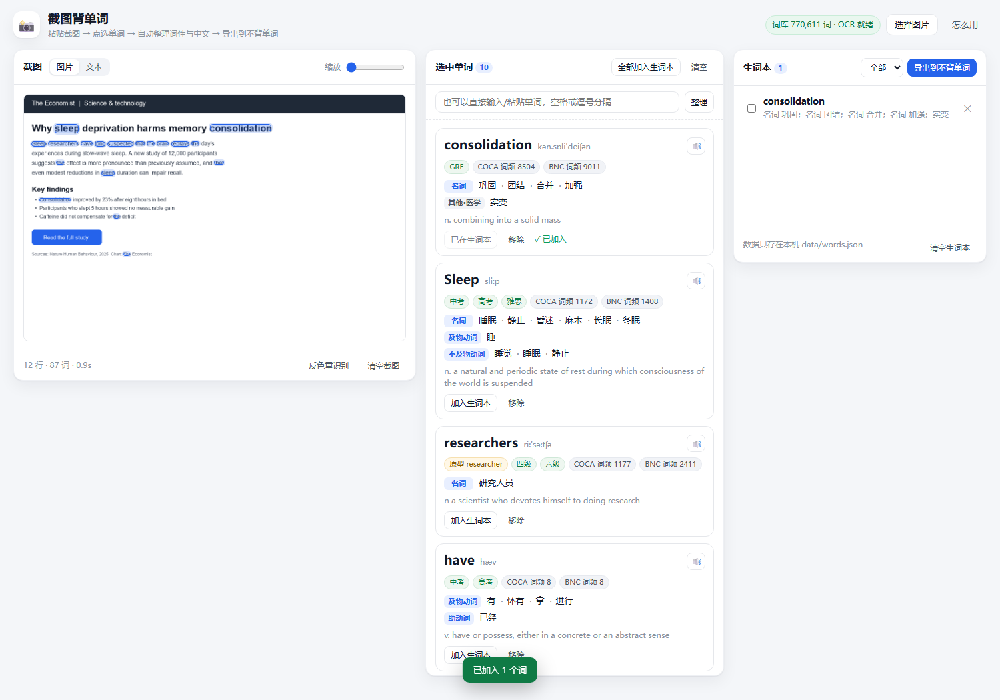

# 截图背单词 · Snap Vocab

[](https://github.com/GUSIHANGLUTA/snap-vocab)
[](LICENSE)
[](https://github.com/GUSIHANGLUTA/snap-vocab/releases/latest)

给一张英文截图，点选里面的单词，自动整理**词性 + 中文释义**，攒够一批一键导出成**不背单词「自制词书」**的 txt —— 导入就能背。

全部在本机跑：OCR 是本地 tesseract，词库是本地 ECDICT（77 万词），不联网也能用。



> **在线地址说明**：GitHub Pages 提供项目介绍和下载入口；完整 OCR、查词与生词本功能需要在本机启动 Node 服务。

[项目主页](https://GUSIHANGLUTA.github.io/snap-vocab/) ·
[下载最新版本](https://github.com/GUSIHANGLUTA/snap-vocab/releases/latest) ·
[参与开源](https://github.com/GUSIHANGLUTA/snap-vocab)

## 快速开始

双击 **`启动截图背单词.cmd`**（首次会自动装依赖、建词库），浏览器会打开 <http://127.0.0.1:8910>。

命令行方式：

```bat
cd /d D:\新建文件夹\english-app
npm.cmd install
npm.cmd start
```

> 注意用 `npm.cmd` 而不是 `npm`：本机 PowerShell 执行策略禁止运行 `npm.ps1`。
> 端口被占用时：`set PORT=8911` 再启动。

## 怎么用

1. **给截图**：`Win` + `Shift` + `S` 截图，回到页面直接 `Ctrl` + `V`；也可以拖图片进来、点「选择图片」。
2. **选单词**（三种方式，可混用）：
   - 在截图上**直接点单词**，选中会高亮，再点一下取消；
   - 切到「文本」标签，像普通文字一样**鼠标拖选**一整句；
   - 或者在输入框里手动敲/粘贴单词。
3. **看整理结果**：右侧卡片给出音标、按词性分组的中文释义（名词/及物动词/形容词…）、考试标签（中考/高考/四级/六级/考研/托福/雅思/GRE）、COCA/BNC 词频，以及**原形还原**（`screens → screen`、`ran → run`）。
4. **加入生词本**：单张卡片点「加入生词本」，或点「全部加入生词本」。
5. **导出到不背单词**：点「导出到不背单词」→「复制」或「下载」拿到 `bubei-日期时间.txt`。

## 导出到不背单词（官方途径）

不背单词**没有公开接口**，官方支持的是「自制词书」上传，四步：

1. 复制 / 下载上一步的 txt（一行一个英文单词，官网只认英文部分）；
2. 浏览器打开 <https://bbdc.cn/lexis_book_index> 登录（手机号或微信）；
3. 网页左上角点「自制词书」，上传 txt —— 官网会用自己的词库重新匹配释义和例句；
4. 稍等片刻刷新网页，手机 App 里点「词书 / 换本词书 → 自制」就能开始背。

导出面板里也内置了这四步说明，右侧按钮可直接跳官网。

## 数据与隐私

| 内容 | 位置 |
| --- | --- |
| 你的生词本 | `data/words.json` |
| 本地词库（ECDICT 77 万词，96MB） | `data/dict.sqlite`（首次启动自动生成） |
| OCR 语言数据 / 缓存 | `node_modules/@tesseract.js-data/eng`、`data/tesseract-cache/` |

截图只在内存里传给本机 `127.0.0.1` 的识别进程，不落盘、不出本机。
唯一会联网的操作是你**主动**点卡片上的「在线补全」（走有道词典的非官方接口），本地词库查不到时才需要。

## 技术实现

```
src/server.ts      本机 HTTP 服务：静态页 + JSON API（只监听 127.0.0.1）
src/ocr.ts         tesseract.js（eng，PSM 稀疏文本）→ 词级 bbox；Worker 串行队列
src/dict.ts        ECDICT 查询 + 词性/释义解析 + 屈折还原链
src/dict-build.ts  ecdict.csv + lemma.en.txt → data/dict.sqlite（node:sqlite）
src/wordbook.ts    生词本（JSON + 原子写）
src/export.ts      不背单词 txt / CSV 生成
src/online.ts      可选：有道在线补全
public/            原生 ESM 前端（无框架、无构建）
test/              node --test 单测（28 项）
tools/e2e.mts      无头 Chrome CDP 端到端验证（27 项，含截图）
```

几个关键决定：

- **为什么不用 Windows 自带 OCR**：本机只有 `ja` / `zh-Hans-CN` 识别引擎，没有英文，实测识别英文不可靠。
- **为什么 OCR 给词级 bbox**：这样前端才能把「图片上的词」变成可点的热区，实现「点截图里的单词」而不是只能选文本。
- **屈折还原链**：精确匹配 → ECDICT `exchange` 反查 → `lemma.en.txt` → 规则变形（`-s/-ed/-ing/-ies/-ly` 等）。所以 `screens`、`ran`、`Companies'` 都能回到原形并带出完整释义和考试标签。
- **词性解析**：ECDICT 的 `translation` 行首是 `n. / vt. / a.` 这类缩写，按行拆开映射成中文词性；`[网络] [计] [医]` 这类方括号当作领域标签，不当作词性。

## 开发命令

```bat
npm.cmd start          :: 启动服务
npm.cmd test           :: 单测（词性解析、还原、导出格式、生词本、OCR 回归）
npm.cmd run e2e        :: 无头 Chrome 端到端验证，并输出 screenshots/e2e-*.png
npm.cmd run dict:build :: 重建本地词库（--force 覆盖）
npm.cmd run type-check :: tsc --noEmit
node tools/_probe-ocr.mts 某张图.png  :: 单独排查某张图的 OCR 结果
```

## 已知限制

- **OCR 只装英文模型**：中文截图里的中文不会被识别成可查词（要中文识别需再加 `@tesseract.js-data/chi_sim`）。
- **浅色页面里的深色块**（深色顶栏、深底按钮上的白字）第一遍可能漏识；底部有「反色重识别」按钮可以补一次。整张图偏暗时会**自动反色**，无需手动。
- **词组/习语**：ECDICT 里没有的固定搭配会提示「未收录」，可以点「在线补全」或手动记到生词本备注。
- **不背单词没有 API**：导出是官方「自制词书」上传途径，没法做到「程序里点一下直接进 App 词书」。
- 生词本用 `data/words.json`，不要手动改文件结构；删掉它等于清空生词本。

## 许可证

本项目采用 [MIT License](LICENSE) 开源。你可以自由使用、修改和分发，但请保留许可证声明。
